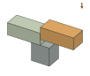

# Lige stød

To bjælker er for korte. Stolpen mellem dem er til gengæld bred nok til, at begge ender kan hvile på den. Her begynder det lige stød, en af de enkleste måder at lade en vandret rem fortsætte gennem huset på.

Tømreren skærer hver ende vinkelret af. Det første stykke får plads på den ene side af stolpens top. Det næste sænkes ned ved siden af. Fra siden kan alt arbejdet ende med at se ud som en enkelt lodret blyantstreg.

Vil du forstå den streg, så kig nedenunder. Hvor langt når hver ende ind på stolpen? Det er dér, du finder de to små flader, som bjælkerne faktisk hviler på.

[Koch · Lige stød](https://danskbyggeskik.dk/publikationer/ordbog_fagudtryk_fra_det_traditionelle_byggeri.pdf#page=30)

[SolidCraft-model](model.sc) · [Modelopskrift](model.json) · [Bogen](../README.md)
