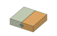
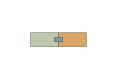

# Pløjning med løs fjeder

Begge brætkanter kan have not. Forbindelsen mellem dem bliver først synlig, når den løse fjeder kommer frem.

## Samleretningen

Læg den blågrå fjeder i det første bræts not. På tegningen er den allerede placeret dér. Før det andet bræt på tværs hen over dens frie halvdel.

## Læs snittet

Snittet har tre trædele. Følg fugen langs begge sider af den blågrå liste. Den gennemgående linje mellem brædderne er synlig udenpå i begge typer pløjning.

## Ved en besigtigelse

Ved registrering tælles den løse fjeder som en selvstændig del. Angiv om den blev set i enden, fundet løs eller alene er foreslået ud fra en tegning.

[G. v. Huth · fig. 12 · PDF-s. 6](https://danskbyggeskik.dk/publikationer/324%20-%20tr%C3%A6forbindelser%20for%20br%C3%A6der,%20planker%20og%20t%C3%B8mmer.%2024%20tavler%20med%20bem%C3%A6rkninger.pdf#page=6) · [G. v. Huth · tegning 12 · PDF-s. 16](https://danskbyggeskik.dk/publikationer/324%20-%20tr%C3%A6forbindelser%20for%20br%C3%A6der,%20planker%20og%20t%C3%B8mmer.%2024%20tavler%20med%20bem%C3%A6rkninger.pdf#page=16)

[SolidCraft-model](model.sc) · [Modelopskrift](model.json) · [Bogen](../README.md)
