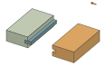
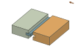

# Pløjning med løs fjeder

Man løfter et bræt fri, og en tynd liste bliver siddende i kanten. Ved første blik kunne listen være en del af brættet. Ser man efter på endefladen, dukker der en fuge op på begge sider af den.

Her har begge brædder en not. Mellem dem ligger en løs fjeder, vist med blågrå farve. Først lægges den i den ene not. Derefter føres det andet bræt hen over den halvdel, der stadig stikker ud.

Ved nedtagning er den lille liste en del, man kan miste. Læg den sammen med brædderne og tegn dens profil. Så ved den næste, hvorfor der er riller i begge kanter.

[G. v. Huth · fig. 12 · PDF-s. 6](https://danskbyggeskik.dk/publikationer/324%20-%20tr%C3%A6forbindelser%20for%20br%C3%A6der,%20planker%20og%20t%C3%B8mmer.%2024%20tavler%20med%20bem%C3%A6rkninger.pdf#page=6) · [G. v. Huth · tegning 12 · PDF-s. 16](https://danskbyggeskik.dk/publikationer/324%20-%20tr%C3%A6forbindelser%20for%20br%C3%A6der,%20planker%20og%20t%C3%B8mmer.%2024%20tavler%20med%20bem%C3%A6rkninger.pdf#page=16)

[SolidCraft-model](model.sc) · [Modelopskrift](model.json) · [Bogen](../README.md)
