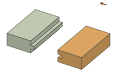
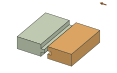
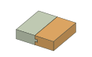
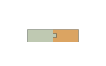

# Pløjning med fast fjeder

På et færdigt bræddegulv kan man følge fugen mange meter uden at blive klogere på, hvad der ligger under den. Ved en fri bræddeende er én centimeter ofte nok.

På det grønne bræt har tømreren ladet en smal tunge stå langs kanten. Den kaldes fjederen. Det andet bræt får en lang rille, noten. Før brædderne sidelæns sammen, og fjederen forsvinder ind i noten.

På endefladen kan du følge træet hele vejen fra brættet og ud i tungen. Det er sådan, du ser, at fjederen er fast. I næste forbindelse ligger der et tredje stykke træ på samme sted.

[G. v. Huth · fig. 13 · PDF-s. 6](https://danskbyggeskik.dk/publikationer/324%20-%20tr%C3%A6forbindelser%20for%20br%C3%A6der,%20planker%20og%20t%C3%B8mmer.%2024%20tavler%20med%20bem%C3%A6rkninger.pdf#page=6) · [G. v. Huth · tegning 13 · PDF-s. 16](https://danskbyggeskik.dk/publikationer/324%20-%20tr%C3%A6forbindelser%20for%20br%C3%A6der,%20planker%20og%20t%C3%B8mmer.%2024%20tavler%20med%20bem%C3%A6rkninger.pdf#page=16)

[SolidCraft-model](model.sc) · [Modelopskrift](model.json) · [Bogen](../README.md)
