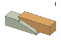
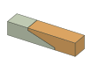

# Skråt blad

Ved en længdesamling kan tykkelsen af bladet ændre sig hele vejen fra skulder til spids. Den tykke del bliver siddende ved sit eget emne.

## Samleretningen

Læg den tynde ende af overbladet ved underbladets tykke rod. Sænk det, til de skrå flader mødes. I eksemplet er spidserne 3 mm af den samlede højde på 18 mm.

## Læs snittet

Profilen har små lodrette skuldre ved begge ender af den skrå flade. Følg dem for at skelne et skråt blad fra en skrå afskæring, der ender i nul.

## Ved en besigtigelse

Se efter både anlæg under samlingen og eventuelle nagler eller bolte. Bogen beskriver begge forhold; demonstrationen åbner træfladerne før fastholdelse.

[Kaare Kristensen · fig. 20 · PDF-s. 26](https://danskbyggeskik.dk/publikationer/487%20-%20t%C3%B8mrerarbejde.pdf#page=26)

[SolidCraft-model](model.sc) · [Modelopskrift](model.json) · [Bogen](../README.md)
