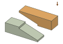
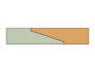

# Skråt blad

Et tyndt stykke træ er let at få øje på mellem fingrene. På det skrå blad sidder den tynde ende længst ude, mens tømreren har ladet mere træ stå tilbage inde ved roden, hvor bladet vokser ud af bjælken.

Vend den anden bjælke modsat. Dens tynde ende lander nu over den førstes tykke del. Lader du blikket løbe langs fugen fra siden, følger du én lang skrå flade mellem to korte, lodrette skuldre.

Læg især mærke til spidsen. I bogens eksempel er der stadig 3 mm træ tilbage af de oprindelige 18 mm. Den lille kant giver et synligt spor, også når bjælkerne ligger samlet.

[Kaare Kristensen · fig. 20 · PDF-s. 26](https://danskbyggeskik.dk/publikationer/487%20-%20t%C3%B8mrerarbejde.pdf#page=26)

[SolidCraft-model](model.sc) · [Modelopskrift](model.json) · [Bogen](../README.md)
