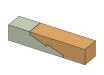

# Skråt hageblad

Følgen af snit er næsten som en håndbevægelse: ned langs en skrå flade, et kort spring op, og ned igen. Springet midt på bladet gør det til et skråt hageblad.

De to halvdele passer mod hinanden fra oven. Når overbladet er sænket, ligger de lange skrå flader an, og den korte kant ved springet griber bag sit modstykke. På den måde har tømreren givet forskellige flader hver sin opgave.

Hvis du tegner en gammel samling, så begynd ved den ene skulder og følg hele vejen til den anden. Stop blyanten, hvor træet forsvinder bag en beklædning. Det manglende stykke kan være netop det lille hak, der skelner de to slags blade.

[Kaare Kristensen · fig. 22 · PDF-s. 26](https://danskbyggeskik.dk/publikationer/487%20-%20t%C3%B8mrerarbejde.pdf#page=26)

[SolidCraft-model](model.sc) · [Modelopskrift](model.json) · [Bogen](../README.md)
