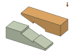
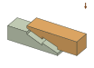
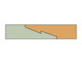

# Skråt hageblad

På et slidt stykke tømmer kan et enkelt trin ligne et nyt indhug. Se på fladen på begge sider af trinnet, før du bestemmer samlingen.

## Samleretningen

Lad de to skrå bladflader nærme sig samtidig. I sidste del af sænkningen passer den tykkere spids ned bag den anden dels hage.

## Læs snittet

Hakket ses som et spring midt i det skrå længdesnit. Uden springet ville profilen kunne læses som det skrå blad.

## Ved en besigtigelse

Tegn rod, midtertrin og spids. Hvis én af de tre er skjult, kan du markere den som uafklaret i stedet for at tegne hagen symmetrisk af vane.

[Kaare Kristensen · fig. 22 · PDF-s. 26](https://danskbyggeskik.dk/publikationer/487%20-%20t%C3%B8mrerarbejde.pdf#page=26)

[SolidCraft-model](model.sc) · [Modelopskrift](model.json) · [Bogen](../README.md)
