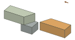
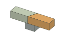

# Skråt stød

En rem krydser en understøtning på skrå. I plan kan tømreren lade stødet følge understøtningens retning. Den grå understøtning er på modellen reduceret til et bredt anlægsfelt.

## Samleretningen

Før enderne sammen på langs. Hele endefladen er skåret skråt i plan. Der er hverken et underblad eller en tap at lægge på plads.

## Læs snittet

Set ovenfra mødes enderne langs én skrå linje. Set fra siden kan den samme samling ligne et almindeligt lige stød.

## Ved en besigtigelse

Tegn støttens og remmens retning på samme skitse. Hvis du kun har et facadefoto, kan vinklen mellem dem mangle helt.

[Kaare Kristensen · fig. 16 · PDF-s. 26](https://danskbyggeskik.dk/publikationer/487%20-%20t%C3%B8mrerarbejde.pdf#page=26)

[SolidCraft-model](model.sc) · [Modelopskrift](model.json) · [Bogen](../README.md)
