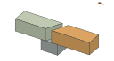
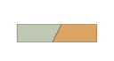

# Skråt stød

Prøv at lægge en lineal skråt hen over en planke. Lad de to bjælkeender mødes langs linealen, og du har ideen i et skråt stød. Tømreren kan på den måde lade fugen følge en støtte, der går skråt under remmen.

Begge ender får samme skrå snit. Når bjælkerne føres sammen på langs, mødes endefladerne fra kant til kant. Set oppefra tegner samlingen en diagonal. Ser du kun bjælkens side, får du måske øje på en ganske almindelig lodret fuge.

Derfor er det værd at gå et skridt til siden med skitsebogen. Få både bjælkens kanter og støttens retning med på samme tegning. Så bliver det synligt, hvorfor tømreren har lagt snittet netop dér.

[Kaare Kristensen · fig. 16 · PDF-s. 26](https://danskbyggeskik.dk/publikationer/487%20-%20t%C3%B8mrerarbejde.pdf#page=26)

[SolidCraft-model](model.sc) · [Modelopskrift](model.json) · [Bogen](../README.md)
