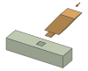
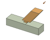
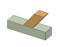

# Skrå tap i et bånd

Forestil dig at rejse et skråbånd i et bindingsværksfag. Tappen skal ind i remmen, men den sidder på enden af et stykke træ, der peger skråt op. Tømreren må tænke på hele båndets bevægelse, allerede når hullet mærkes op.

Følg pilen ned langs båndet. Tappen og hullet har samme skrå retning, og ved skuldrene går tappen over i båndets fulde bredde. På denne tegning kan du se den enkle form før en eventuel nagling.

Prøv så at sætte en stolpe mere ind i dit tænkte fag. Er der stadig plads til at føre båndet ind? En detalje, der er let at samle på bukkene, kan bestemme, i hvilken rækkefølge hele væggen må rejses.

[Kaare Kristensen · fig. 45 · PDF-s. 28](https://danskbyggeskik.dk/publikationer/487%20-%20t%C3%B8mrerarbejde.pdf#page=28)

[SolidCraft-model](model.sc) · [Modelopskrift](model.json) · [Bogen](../README.md)
