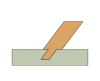

# Skrå tap i et bånd

Et skråbånd møder en vandret rem med en spids og en stump vinkel. En lodret montagepil ville sende tappen ind i hullets side.

## Samleretningen

Følg båndets akse ned mod venstre i modellens længdesnit. Det skrå hul har samme retning. Her ses en enkel tap uden ekstra forsætning eller nagle.

## Læs snittet

I længdesnittet kan du forlænge tappens to lange sider op i båndet. Ved skuldrene begynder båndets fulde bredde.

## Ved en besigtigelse

Registrér hvor der er plads til at føre tappen ind sammen med resten af faget. Den frie vej for én løs del kan være spærret, når nabostolpen allerede står.

[Kaare Kristensen · fig. 45 · PDF-s. 28](https://danskbyggeskik.dk/publikationer/487%20-%20t%C3%B8mrerarbejde.pdf#page=28)

[SolidCraft-model](model.sc) · [Modelopskrift](model.json) · [Bogen](../README.md)
