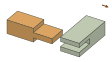
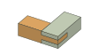

# Slidstap

Ved enden af en rammedel kan slidsen stå åben som en gaffel. Det giver adgang til indgrebet fra enden.

## Samleretningen

Før den flade tap mellem de to kinder. Den viste ramme samles ved at føre den okkerfarvede del hen imod siden af det grønne emne.

## Læs snittet

Plansnittet ligger i tappens højde. Her kan tapenden følges helt til den modsatte side af samlingen. Over og under snitplanet bliver kinderne stående.

## Ved en besigtigelse

Find den åbne ende, før du kalder samlingen en slidstap. Et hul inde på emnets flade kan have samme bredde og stadig være lukket i enden.

[Kaare Kristensen · fig. 51 · PDF-s. 29](https://danskbyggeskik.dk/publikationer/487%20-%20t%C3%B8mrerarbejde.pdf#page=29) · [G. v. Huth · tegning 46 · PDF-s. 20](https://danskbyggeskik.dk/publikationer/324%20-%20tr%C3%A6forbindelser%20for%20br%C3%A6der,%20planker%20og%20t%C3%B8mmer.%2024%20tavler%20med%20bem%C3%A6rkninger.pdf#page=20)

[SolidCraft-model](model.sc) · [Modelopskrift](model.json) · [Bogen](../README.md)
