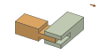

# Slidstap

Se på enden af den grønne rammedel. Den deler sig som en gaffel med to flade kinder. Mellem dem kan man se lige ind fra enden. Det er her, slidstappen skal sidde.

På det andet stykke lader tømreren den midterste del af træet stå som en flad tap. Før den ind mellem kinderne, og de udfylder tilsammen hjørnet. På den viste samling når tapenden helt ud på den modsatte side.

Har du kun adgang til den ene flade på et gammelt hjørne, så led efter den anden. Det lille felt af synligt endetræ dér kan afgøre, om tappen går hele vejen igennem.

[Kaare Kristensen · fig. 51 · PDF-s. 29](https://danskbyggeskik.dk/publikationer/487%20-%20t%C3%B8mrerarbejde.pdf#page=29) · [G. v. Huth · tegning 46 · PDF-s. 20](https://danskbyggeskik.dk/publikationer/324%20-%20tr%C3%A6forbindelser%20for%20br%C3%A6der,%20planker%20og%20t%C3%B8mmer.%2024%20tavler%20med%20bem%C3%A6rkninger.pdf#page=20)

[SolidCraft-model](model.sc) · [Modelopskrift](model.json) · [Bogen](../README.md)
