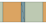

# Fransk lås · se ud gennem endestyret

Den letteste fuge at overse ligger midt i det blågrå træ. Ved første blik ser det ud, som om tømreren har stukket én kile gennem bjælken. Følg den skrå streg helt ud til kanten. Der ligger to.

Kilerne vender hver sin vej. Den ene bliver bredere mod den side af bjælken, hvor den anden bliver smallere. I snittet set oppefra kan du følge begge stykker gennem låsen.

Se så ind i bjælkeenden. Her har tømreren ladet en smal fjeder stå på en bred fod. Når enderne skydes sammen, finder fjederen vej ind i sin udsparing. Det lille endestyr ville du let kunne overse, hvis du kun så bjælken fra siden.

[Kristensen · fransk lås](https://danskbyggeskik.dk/publikationer/487%20-%20t%C3%B8mrerarbejde.pdf#page=27)

[Huth · figur 83](https://danskbyggeskik.dk/publikationer/324%20-%20tr%C3%A6forbindelser%20for%20br%C3%A6der,%20planker%20og%20t%C3%B8mmer.%2024%20tavler%20med%20bem%C3%A6rkninger.pdf#page=24)
