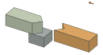
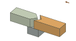

# Lige stød med vinkelstyr

Enden af den grønne bjælke ligner en lav tagryg lagt på siden. Kør en finger hen over enden i tankerne. Først op ad den ene skrå flade, hen over ryggen og ned ad den anden. Begge flader er skåret i selve bjælken.

I den anden ende skærer tømreren den modsatte form. Før bjælkerne sammen på langs, og ryggen finder sit leje. Prøver den ene bjælke at glide til siden, kommer en af de skrå flader i vejen. Det er derfor, ryggen kaldes et styr.

Oppefra er kendemærket et V midt i stødet. Under samlingen skal der stadig være plads til, at begge bjælkeender kan hvile.

[Kaare Kristensen · fig. 17 · PDF-s. 26](https://danskbyggeskik.dk/publikationer/487%20-%20t%C3%B8mrerarbejde.pdf#page=26)

[SolidCraft-model](model.sc) · [Modelopskrift](model.json) · [Bogen](../README.md)
