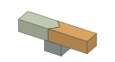
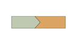

# Lige stød med vinkelstyr

To emner skal ende på samme linje over en støtte. Tømreren kan forme enden med en ryg, der søger ind i en tilsvarende vinkel på den anden del.

## Samleretningen

Før enderne sammen langs remmen. Ryggens to sider møder hver sin skrå flade. Bevægelse på tværs af remmen kræver nu, at delene også åbner sig.

## Læs snittet

I plansnittet ses et V. Spidsen sidder på selve endetræet. Et løst indlagt stykke ville give yderligere fuger.

## Ved en besigtigelse

Find begge V-flader før du navngiver formen. Sammenlign den ene skrå snitlinje ved skråt stød med de to, som mødes her.

[Kaare Kristensen · fig. 17 · PDF-s. 26](https://danskbyggeskik.dk/publikationer/487%20-%20t%C3%B8mrerarbejde.pdf#page=26)

[SolidCraft-model](model.sc) · [Modelopskrift](model.json) · [Bogen](../README.md)
