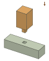
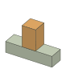

# Styretap

På den brede ende af træet står en lille firkant. Den ser beskeden ud ved siden af skuldrene omkring den, og dens opgave er tilsvarende præcis: Den hjælper stykket med at finde sin plads.

Tømreren har skåret tilbage fra begge sider, så tappen bliver kvadratisk. Når den lander i hullet, styres emnet af tappens sider. Samtidig kan de brede skuldre få anlæg på træet nedenunder.

Ved et hjørne er det værd at stille to spørgsmål. Hvad holder træet på det rigtige sted under samlingen? Og hvad sikrer det færdige hjørne mod at åbne sig? En lille styretap kan give svaret på det første, længe før du kender svaret på det andet.

[Kaare Kristensen · fig. 54 · PDF-s. 29](https://danskbyggeskik.dk/publikationer/487%20-%20t%C3%B8mrerarbejde.pdf#page=29)

[SolidCraft-model](model.sc) · [Modelopskrift](model.json) · [Bogen](../README.md)
