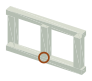
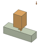
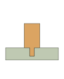

# Styretap

En lille tap kan først og fremmest styre, hvor et emne lander. Kristensen beskriver typen ved hjørneforbindelser og gør opmærksom på dens begrænsede opgave.

## Samleretningen

Ret den lille firkant ind efter hullet og sænk emnet. På hver side er der skåret materiale bort, så der står skuldre tilbage.

## Læs snittet

Det lodrette snit viser skuldrene på begge sider af tappen. Se dernæst den adskilte del; her kan man også se, at tappen er kvadratisk i plan.

## Ved en besigtigelse

Læs træets anlæg og tappens styring hver for sig. En lille styretap alene fortæller ikke, hvordan konstruktionen er sikret mod at løfte sig.

[Kaare Kristensen · fig. 54 · PDF-s. 29](https://danskbyggeskik.dk/publikationer/487%20-%20t%C3%B8mrerarbejde.pdf#page=29)

[SolidCraft-model](model.sc) · [Modelopskrift](model.json) · [Bogen](../README.md)
