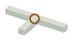
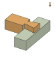

# Svalehaleformet blad

En stikbjælke møder siden af en gennemgående bjælke. Bladets hoved er bredere end halsen og kan ses ovenfra, når oversiden er fri.

## Samleretningen

Sænk bladet i den tilpassede udskæring. Hovedet kan passere ovenfra, mens skråflankerne standser en direkte bevægelse ud gennem den smallere hals.

## Læs snittet

Plansnittet gennem bladet viser halsen og begge flanker. Under bladet har det gennemgående emne stadig en bund.

## Ved en besigtigelse

Find ud af, om udskæringen har bund eller går gennem hele emnet. Den forskel forsvinder let på en plantegning alene.

[Kaare Kristensen · fig. 35 · PDF-s. 28](https://danskbyggeskik.dk/publikationer/487%20-%20t%C3%B8mrerarbejde.pdf#page=28)

[SolidCraft-model](model.sc) · [Modelopskrift](model.json) · [Bogen](../README.md)
