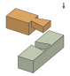
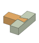
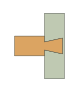

# Svalehaleformet blad

Hovedet er for bredt til at komme ud gennem halsen. Den lille svalehalefigur i en bjælkeende bliver let at huske, når man først har prøvet at forestille sig dén bevægelse.

Tømreren former bladet bredt fortil og smalt inde ved bjælken. Den grønne bjælke får en udskæring med samme form i oversiden. Oppefra er der fri adgang. Når bladet er sænket, møder det brede hoved de skrå flanker, hvis bjælken trækkes lige ud.

Kig ned i udskæringen på den adskilte figur. Der er en bund af træ under bladet. Den oplysning får du med det samme på værkstedsbordet. På en plantegning af den lukkede samling skal der et snit til.

[Kaare Kristensen · fig. 35 · PDF-s. 28](https://danskbyggeskik.dk/publikationer/487%20-%20t%C3%B8mrerarbejde.pdf#page=28)

[SolidCraft-model](model.sc) · [Modelopskrift](model.json) · [Bogen](../README.md)
