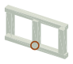
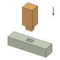
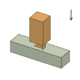
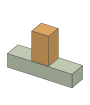
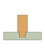

# Stolpens lige tap

Ved stolpens fod kan hele samlingen gemme sig bag én vandret fuge. Den brede ende af stolpen hviler på remmen, mens en smallere del fortsætter ned i et hul. Det er tappen.

Løft stolpen på tegningen. Afsatserne rundt om tappen hedder skuldrene. Når stolpen sænkes igen, møder de remmens overside. I eksemplet er der lidt luft under tapspidsen, så skulderen kan komme helt ned og ligge an.

På styrelsens tegning af bindingsværk går der også en nagle på tværs. Den detalje giver et godt spor at lede efter på siden af en rigtig rem, hvor selve tappen for længst er forsvundet ind i træet.

[Slots- og Kulturstyrelsen · figur C](https://slks.dk/fileadmin/user_upload/SLKS/Omraader/Kulturarv/Bygningsfredning/Faglige_retningslinjer/3_Facader_og_ydervaegge/3.2_Bindingsvaerk.pdf#page=15) · [Koch · Tap](https://danskbyggeskik.dk/publikationer/ordbog_fagudtryk_fra_det_traditionelle_byggeri.pdf#page=50)

[SolidCraft-model](model.sc) · [Modelopskrift](model.json) · [Bogen](../README.md)
