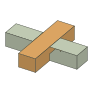

# 相欠 · Aigaki

Se krydset fra oven. Fire arme går ud fra det samme lille felt, og alle fire oversider ligger i højde med hinanden. Hvordan er der blevet plads til begge bjælker?

Tømreren har taget halvdelen af højden fra oversiden af den ene og halvdelen fra undersiden af den anden. Sænk den sidste bjælke på plads. I toppen af krydset kan du følge dens træ hele vejen igennem. Nedenunder løber den første bjælke på tværs.

Aigaki kan også sidde ved et hjørne. Tæl derfor de ender, der går videre ud fra det sted, du ser på. Det er en lille oplysning, som en nærtegning af selve indhakket let mister.

[JAANUS · aigaki](https://www.aisf.or.jp/~jaanus/deta/a/aigaki.htm)

[SolidCraft-model](model.sc) · [Modelopskrift](model.json) · [Bogen](../README.md)
