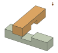
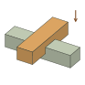

# 相欠 · Aigaki

Følg to emner, der krydser vinkelret. Aigaki bruges også ved hjørner. Her undersøger vi krydset, hvor begge emner fortsætter ud på begge sider.

## Samleretningen

Tag halvdelen af højden i det ene emnes overside og halvdelen i det andets underside. Den viste montage sænker det øvre blad direkte ned i krydset.

## Læs snittet

Det vandrette snit i øverste halvdel følger kun det ene emne gennem krydset. Efter samling ligger oversiderne i samme plan. JAANUS nævner flere former for fastgørelse.

## Ved en besigtigelse

Følg alle fire ender i den samlede figur. Sammenlign dernæst med det danske hjørneblad, hvor der kun går to arme ud fra samlingen.

[JAANUS · aigaki](https://www.aisf.or.jp/~jaanus/deta/a/aigaki.htm)

[SolidCraft-model](model.sc) · [Modelopskrift](model.json) · [Bogen](../README.md)
