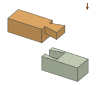
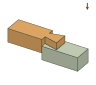

# 腰掛蟻継 · Koshikake-aritsugi

På bunden af udskæringen er der plads til at lægge en finger. Det brede svalehalehoved har fået sit eget sæde. Koshikake-aritsugi forener to former, som hver for sig er lette at kende.

Før hovedet ind over åbningen og sænk det. Sædet tager imod undersiden. De skrå flanker møder hovedets sider, hvis enderne forsøges trukket fra hinanden langs bjælken.

Se først ned på det samlede træ, og find svalehalehalsen. Se dernæst på den adskilte tegning og find sædet nedenunder. Det kræver de to udsigter at få hele navnets mening med.

[JAANUS · aritsugi](https://www.aisf.or.jp/~jaanus/deta/a/aritsugi.htm)

[SolidCraft-model](model.sc) · [Modelopskrift](model.json) · [Bogen](../README.md)
