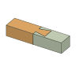
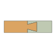

# 腰掛蟻継 · Koshikake-aritsugi

Når bjælker skal forlænges, kan et sæde kombineres med en svalehale. JAANUS’ figur viser den kombinerede variant under det bredere opslag aritsugi.

## Samleretningen

Lad det bredere hoved gå ned i modformen fra oven. Det nederste træ i modtageren giver sædet under det udragende hoved.

## Læs snittet

Det høje plansnit viser svalehalehalsen; sædet ligger under snitplanet. I den adskilte figur kan man se begge anlæg på samme tid.

## Ved en besigtigelse

Sammenlign med både aritsugi og koshikaketsugi. Peg på den konkrete flade, der er tilføjet i forhold til den gennemgående bræddesamling.

[JAANUS · aritsugi](https://www.aisf.or.jp/~jaanus/deta/a/aritsugi.htm)

[SolidCraft-model](model.sc) · [Modelopskrift](model.json) · [Bogen](../README.md)
