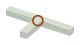
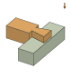
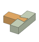
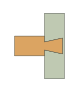

# 蟻掛 · Arikake

En bjælke kan ende mod langsiden af en anden. Her sættes en svalehale på omtrent en halv bjælkehøjde i en tilsvarende udskæring i den gennemgående del.

## Samleretningen

Før den smalle hals forbi bjælkens side, mens hovedet er hævet. Sænk derefter bladet i lejet. Den afbildede form svarer til første betydning i JAANUS-opslaget.

## Læs snittet

I plansnittet ses den vinkelrette tilslutning, den brede ende og halsen. Følg den grønne bjælke forbi samlingen i begge retninger.

## Ved en besigtigelse

Begynd ved den gennemgående bjælke. Så er det lettere at skelne en tilslutning fra en længdesamling med næsten samme svalehalekontur.

[JAANUS · arikake](https://www.aisf.or.jp/~jaanus/deta/a/arikake.htm)

[SolidCraft-model](model.sc) · [Modelopskrift](model.json) · [Bogen](../README.md)
