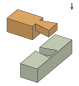

# 蟻掛 · Arikake

Stil dig ved langsiden af den grønne bjælke. Den fortsætter både til højre og til venstre. Det er her, den anden bjælke skal ende, vinkelret på den første.

På enden af den korte bjælke former tømreren en svalehale i omtrent halv højde. Løft hovedet over den åbne udskæring i den lange bjælkes side og sænk det. Set fra oven kan du nu følge de skrå flanker helt ind til halsen. Nedenunder hviler bladet på træet i den gennemgående bjælke.

Svalehaleformen ligner den, du så ved bræddernes forlængelse. Træd et skridt tilbage, og forskellen bliver tydelig: Her går én bjælke lige igennem, mens den anden slutter ved dens side. Det er denne udgave af arikake, tegningen viser.

[JAANUS · arikake](https://www.aisf.or.jp/~jaanus/deta/a/arikake.htm)

[SolidCraft-model](model.sc) · [Modelopskrift](model.json) · [Bogen](../README.md)
