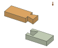
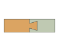

# 蟻継 · Aritsugi

To brædder mødes ende mod ende. På fladsiden ses en tap, der er bredere ved hovedet end ved halsen. JAANUS beskriver blandt andet møbler og dørrammer.

## Samleretningen

Placér tappen ud for den åbne udskæring og sænk den gennem brættets tykkelse. Et forsøg på at føre det brede hoved ind gennem halsen på langs ville blive standset af flankerne.

## Læs snittet

Plansnittet gennem brædderne viser den udadgående bredde og de to flanker. Her er valgt en gennemgående undervisningsvariant. JAANUS viser desuden en sammensat variant med sæde.

## Ved en besigtigelse

Hold øje med halsen og træet på hver side af udskæringen. Formens indgreb fortæller, hvilken bevægelse den spærrer. Brudlasten kræver andre oplysninger.

[JAANUS · aritsugi](https://www.aisf.or.jp/~jaanus/deta/a/aritsugi.htm)

[SolidCraft-model](model.sc) · [Modelopskrift](model.json) · [Bogen](../README.md)
