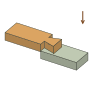
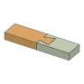

# 蟻継 · Aritsugi

Hvordan får man et bredt hoved ind gennem en smal hals? Løft det op over brættet. Det lille retningsskift er hele fornøjelsen ved at prøve en aritsugi mellem hænderne.

På det ene bræt skærer tømreren en tap med skrå sider. Det andet får en udskæring med samme kontur. Hovedet sænkes ind fra fladsiden. Prøv nu at trække brædderne fra hinanden på langs. Det brede træ møder de to skrå flanker, længe før hovedet kan slippe ud.

Eksemplet her går igennem brættets tykkelse. På JAANUS’ tegning kan du også se en udgave, hvor der stadig er træ under hovedet. Vend siden, og se hvad den bund gør ved samlingen.

[JAANUS · aritsugi](https://www.aisf.or.jp/~jaanus/deta/a/aritsugi.htm)

[SolidCraft-model](model.sc) · [Modelopskrift](model.json) · [Bogen](../README.md)
