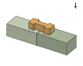
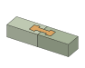

# 千切継 · Chigiritsugi

Tæl træstykkerne, før du følger stregerne. To bjælker ligger ende mod ende, og oven over fugen svæver et tredje lille stykke. Det har et hoved i hver ende.

Tømreren former et leje i begge bjælker. Når det løse stykke sænkes, får det ene hoved fat i den venstre bjælke og det andet i den højre. Den smalle hals kommer til at spænde lige hen over stødet. Under den ligger der stadig træ.

I den forrige samling voksede hoved og hals ud af selve bjælken. Her kan begge bjælker blive liggende, mens man løfter forbindelsesstykket frit. Den forskel er let at mærke i hånden og let at overse på en plantegning.

[JAANUS · kamatsugi](https://www.aisf.or.jp/~jaanus/deta/k/kamatsugi.htm)

[SolidCraft-model](model.sc) · [Modelopskrift](model.json) · [Bogen](../README.md)
