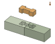
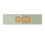

# 千切継 · Chigiritsugi

En tredje del kan binde to bjælkeender sammen. JAANUS beskriver en variant med et kroghoved i hver ende af en løs tap.

## Samleretningen

Lad bjælkeenderne mødes. Sænk derefter det okkerfarvede dobbeltstykke ned i de to åbne lejer. Hvert hoved får fat i sit eget emne.

## Læs snittet

I plansnittet kan halsen følges hele vejen hen over bjælkernes stød. Der står stadig træ under den løse del i denne variant.

## Ved en besigtigelse

Markér de to bjælker og det løse stykke særskilt. En enkelt synlig kontur kan ellers let blive læst som en tap skåret ud af den ene bjælke.

[JAANUS · kamatsugi](https://www.aisf.or.jp/~jaanus/deta/k/kamatsugi.htm)

[SolidCraft-model](model.sc) · [Modelopskrift](model.json) · [Bogen](../README.md)
