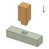

# 平ほぞ · Hirahozo

Løft stolpen fra remmen. På dens ende sidder en mindre firkant af træ, omgivet af brede skuldre. Det er en hirahozo, en lige tap. Hullet i remmen ligger åbent, så man kan se, hvad der skal tage imod den.

Lad stolpen synke langs sin egen akse. Først forsvinder tapspidsen, så siderne, og til sidst lander skuldrene på remmen. I denne korte variant er der lidt luft mellem spidsen og hullets bund.

Nu er der kun fugen ved skuldrene tilbage at se. Man kan kende stedet, hvor delene mødes, uden at kende tappens længde. Den afskårne tegning giver en udsigt, man sjældent får i det færdige hus.

[JAANUS · hirahozo](https://www.aisf.or.jp/~jaanus/deta/h/hirahozo.htm)

[SolidCraft-model](model.sc) · [Modelopskrift](model.json) · [Bogen](../README.md)
