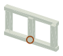
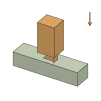
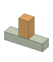
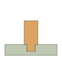

# 平ほぞ · Hirahozo

En stolpe kan slutte i en rektangulær tap med skuldre omkring. JAANUS skelner blandt andet mellem korte og lange tappe; stedet i konstruktionen har betydning for valget.

## Samleretningen

Ret den rektangulære tap ind efter hullet i den vandrette del. Før den ned langs stolpens længderetning. Skulderen når remmen, mens modellens tapspids har fri afstand til bunden.

## Læs snittet

Det lodrette snit viser forskellen på den brede skulder og tappens smalle endeflade. Den valgte korte, blinde variant er tegnet med egne illustrationsmål.

## Ved en besigtigelse

Find først retningen på tappen. Spørg derefter, om tegningen viser hullets bund. Et længdemål for det skjulte træ kan ikke aflæses på den færdige yderside.

[JAANUS · hirahozo](https://www.aisf.or.jp/~jaanus/deta/h/hirahozo.htm)

[SolidCraft-model](model.sc) · [Modelopskrift](model.json) · [Bogen](../README.md)
