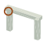
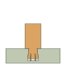

# 地獄ほぞ · Jigokuhozo

To små kiler stikker frem af tapenden. De skal med ind i et blindt hul, og når samlingen er færdig, kan tømreren ikke længere nå dem. Så hvordan får kilerne det sidste tryk? Det får de af hullets bund.

Kilerne sidder først løst i hver sin slids. Når tappen føres ind, rammer deres ender bunden før selve tapspidsen. Fortsætter stolpen det sidste stykke, presses kilerne op i slidserne. Tapenden breder sig ud i det hulrum, tømreren har gjort bredere forneden.

Se på de to snit bag i bogen: Samme tap, først ved berøring, siden spændt ud. Nu er enden bredere end mundingen. Den bevægelse, der førte træet ind, kan ikke bare spilles baglæns. Det får betydning den dag, nogen vil skille huset eller møblet ad.

[JAANUS · jigokuhozo](https://www.aisf.or.jp/~jaanus/deta/j/jigokuhozo.htm)

[SolidCraft-model](model.sc) · [Modelopskrift](model.json) · [Uspredt tap med løse kiler](model-foer.sc) · [Opskrift til den uspredte tap](model-foer.json) · [Bogen](../README.md)
