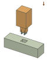
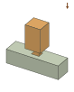
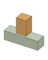

# 地獄ほぞ · Jigokuhozo

I en skjult kilet tap ligger låsningen inde i hullet. De to små kiler sættes løst i tapendens slidser, mens samlingen endnu er åben.

## Samleretningen

Før tap og kiler ned samlet. Når kilernes brede ender rammer hulbunden, kan yderligere indføring presse tapenden ud til siderne. Tegningen skifter her fra en uspredt til en udspændt form.

## Læs snittet

I slutsnittet når kilerne til bunden; tapspidsen har fri afstand. Hulrummet er bredere nederst end ved mundingen. De to CAD-modeller viser geometriske øjebliksbilleder før og efter spredningen.

## Ved en besigtigelse

Overvej adskillelse, før du vælger denne detalje ved genbrug. I lukket tilstand kan kilernes placering være usynlig. Tegningerne beregner hverken træets deformation eller faren for flækning.

[JAANUS · jigokuhozo](https://www.aisf.or.jp/~jaanus/deta/j/jigokuhozo.htm)

[SolidCraft-model](model.sc) · [Modelopskrift](model.json) · [Uspredt tap med løse kiler](model-foer.sc) · [Opskrift til den uspredte tap](model-foer.json) · [Bogen](../README.md)
