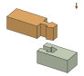
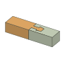
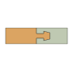

# 鎌継 · Kamatsugi

Spidsen på denne bjælke har både hals og hoved. Følg den smalle hals ud fra det fulde tømmer. Længere ude springer siderne frem og danner et hoved, som på denne form minder om en pil med stump spids.

Når hovedet sænkes ned i modstykket, lander det bag den smallere åbning. Træk langs bjælken, og de to små skuldre ved hovedet kommer til at stå mod det grønne træ. Løft i stedet, og hovedet kan igen komme fri af den åbne udskæring.

Det er værd at dvæle ved de to bevægelser. Tømreren kan med ganske få snit lade en bjælke komme ubesværet ind fra én retning og møde træ fra en anden.

[JAANUS · kamatsugi](https://www.aisf.or.jp/~jaanus/deta/k/kamatsugi.htm)

[SolidCraft-model](model.sc) · [Modelopskrift](model.json) · [Bogen](../README.md)
