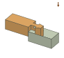

# 鎌継 · Kamatsugi

Ved en bjælkeforlængelse kan enden af det ene emne formes som en hals med et bredere hoved. JAANUS viser en form, hvor hovedet minder om en afstumpet pil.

## Samleretningen

Ret hovedet ind over den åbne udskæring og sænk det. Inde i samlingen ligger hovedets skuldre bag det andet emnes smallere åbning.

## Læs snittet

Plansnittet følger halsen ud til hovedet. Den største bredde kommer et stykke inde på fremspringet. Følg begge kanter tilbage til rødderne.

## Ved en besigtigelse

Hvad kan fastholde emnerne på langs, og hvad ville hindre et lodret løft? Forklar de to bevægelser ud fra modellen hver for sig.

[JAANUS · kamatsugi](https://www.aisf.or.jp/~jaanus/deta/k/kamatsugi.htm)

[SolidCraft-model](model.sc) · [Modelopskrift](model.json) · [Bogen](../README.md)
