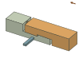
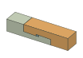

# 金輪継 · Kanawatsugi

To skjulte T-formede ender gør en forskel på byggepladsen: bjælkerne skal kunne forskydes på langs i sidste del af montagen. Den blågrå tværnøgle monteres bagefter.

## Samleretningen

Sænk overstykket lidt forskudt, så enderne kommer i højde med deres lommer. Skyd det derefter langs bjælkeaksen til skuldrene. Før til sidst nøglen på tværs gennem den midterste åbning.

## Læs snittet

Længdesnittet gennem midten viser de modsatrettede endefremspring og tværnøglen. T-hovedets bredde ses bedst i den adskilte figur eller ved at dreje CAD-modellen.

## Ved en besigtigelse

Kan den ene bjælke stadig flyttes på langs, når nabofaget er samlet? Undersøg også adgang til nøglens to ender. Den viste variant har én nøgle; opslaget omtaler flere låseformer.

[JAANUS · kanawatsugi](https://www.aisf.or.jp/~jaanus/deta/k/kanawatsugi.htm)

[SolidCraft-model](model.sc) · [Modelopskrift](model.json) · [Bogen](../README.md)
