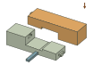
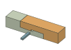
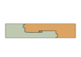

# 金輪継 · Kanawatsugi

Står du med de to halvdele af en kanawatsugi, kan de godt se ud, som om de blot skal lægges oven på hinanden. Prøv at følge det lille T for enden af hvert blad. Hovedet er for bredt til at gå direkte ned gennem halsen på sin lomme.

Tømreren begynder derfor lidt forskudt. Først ned, så enderne kommer i højde, og derefter på langs, så hvert T glider ind bag sin skulder. Midt i bjælken er der nu en fri åbning. Den blågrå tværnøgle føres igennem til sidst.

Gå baglæns gennem samlingen i tankerne. Først må nøglen ud. Derefter skal der være rum til at skyde T-enderne fri. Først da kan den ene bjælke løftes. Med ét bliver den tomme plads omkring bjælken lige så interessant som alt det træ, der er skåret væk.

[JAANUS · kanawatsugi](https://www.aisf.or.jp/~jaanus/deta/k/kanawatsugi.htm)

[SolidCraft-model](model.sc) · [Modelopskrift](model.json) · [Bogen](../README.md)
