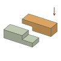
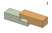
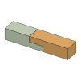
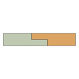

# 腰掛継 · Koshikaketsugi

Den nederste bjælke har fået et sæde. Det er et godt sted at begynde en bog om japanske træsamlinger, for man kan forstå det meste af koshikaketsugi ved at forestille sig vægten af det stykke, man står med i hænderne.

Den ene bjælkeende er skåret som et trin. Den anden vender trinnet modsat. Løft det øverste stykke ind over det nederste og sænk det. Så snart de brede, vandrette flader mødes, har den øverste ende et sted at hvile.

Løft den igen. I denne enkle form er vejen op stadig åben. Senere i bogen vender sædet tilbage sammen med en svalehale. Dér kan du genkende den samme brede flade og samtidig se, hvad det nye indgreb gør.

[JAANUS · koshikaketsugi](https://www.aisf.or.jp/~jaanus/deta/k/koshikaketsugi.htm)

[SolidCraft-model](model.sc) · [Modelopskrift](model.json) · [Bogen](../README.md)
