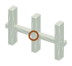
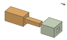
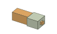

# 大入ほぞ差 · Ōire-hozosashi

Gå om på bagsiden af stolpen. Her stikker en lille ende træ ud. På forsiden kommer en hel bjælke hen imod dig. Sammen afslører de to sider, hvordan bjælken er gjort smallere, inden den passerer gennem stolpen.

Før tappen vandret ind. Den brede skulder standser ved stolpens forside. Den smallere tap fortsætter og viser lidt endetræ på bagsiden. På originaltegningen finder du også en kortere tap, som standser inde i stolpen.

Prøv at følge kun den del, der stikker frem. Hører den til en bjælke, der ender her, eller til et vandret stykke, der fortsætter mod næste stolpe? Nuki på næste side giver den anden mulighed.

[JAANUS · shiguchi](https://www.aisf.or.jp/~jaanus/deta/s/shiguchi.htm)

[SolidCraft-model](model.sc) · [Modelopskrift](model.json) · [Bogen](../README.md)
