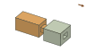
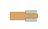

# 大入ほぞ差 · Ōire-hozosashi

Et vandret emne kan ende ved en stolpe med en tap, der når ud på den modsatte side. JAANUS beskriver både kortere og gennemgående indgreb i oversigten over vinklede samlinger.

## Samleretningen

Før tappen vandret ind, indtil skulderen på den større bjælkeende møder stolpen. I den valgte gennemgående variant går tapenden lidt ud over bagsiden.

## Læs snittet

Plansnittet går gennem tappens midterhøjde. Bjælkens fulde bredde standser ved stolpen, mens den smallere del fortsætter. Sammenlign med nuki, hvor det gennemførte emne har konstant tværsnit.

## Ved en besigtigelse

Undersøg den modsatte side. Et synligt endefelt kan høre til en gennemgående tap; et bredere emne, som fortsætter, giver et andet spor.

[JAANUS · shiguchi](https://www.aisf.or.jp/~jaanus/deta/s/shiguchi.htm)

[SolidCraft-model](model.sc) · [Modelopskrift](model.json) · [Bogen](../README.md)
