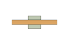

# 貫 · Nuki gennem en stolpe

I en tempel- eller helligdomskonstruktion kan et vandret bindende emne passere gennem en stolpe og fortsætte til den næste. Nuki betegner det vandrette medlem.

## Samleretningen

Skub det lange tværstykke gennem den rektangulære åbning. I eksemplet vises én fri stolpe og træet før en eventuel fastkilning. En hel række stolper kræver en fælles indføringslinje.

## Læs snittet

Plansnittet ligger i åbningens højde. Følg det okkerfarvede træ fra stolpens ene side til den anden. Det har ingen ende inde i stolpen.

## Ved en besigtigelse

Registrér placering, gennemløb og eventuelle kiler hver for sig. JAANUS beskriver også anvendelser i torii, hvor brugen af kiler varierer.

[JAANUS · nuki](https://www.aisf.or.jp/~jaanus/deta/n/nuki.htm)

[SolidCraft-model](model.sc) · [Modelopskrift](model.json) · [Bogen](../README.md)
