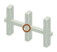
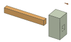
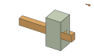
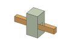

# 貫 · Nuki gennem en stolpe

Følg den vandrette bjælke fra stolpens venstre side til dens højre. I vores eksempel fortsætter den lige igennem. Nuki er navnet på dette gennemgående vandrette træ, der kan forbinde flere stolper i for eksempel en tempelkonstruktion.

Ved en enkelt fritstående stolpe er bevægelsen let at forestille sig: Ret bjælken ind efter det rektangulære hul og skub. Forestil dig så endnu en stolpe på samme linje. Nu bestemmer begge åbninger, hvor bjælken kan føres. I nogle udførelser fastholdes den senere med kiler.

Inde i en rigtig stolpe kan der også gemme sig et stød mellem to bjælkeender. Det var netop det spørgsmål, forskerne ved Kenchōji tog røntgenbilleder for at besvare. Deres undersøgelse følger bag i bogen.

[JAANUS · nuki](https://www.aisf.or.jp/~jaanus/deta/n/nuki.htm)

[SolidCraft-model](model.sc) · [Modelopskrift](model.json) · [Bogen](../README.md)
