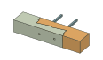
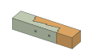

# 追掛大栓継 · Okkake-daisen-tsugi

Forestil dig en bjælkeende så tæt på en væg, at du ikke kan skubbe et nyt stykke ind på langs. Ud for siden er der bedre plads. Okkake-daisen-tsugi er værd at kende her, fordi dens to lange profiler kan mødes fra siden.

Hold de to stykker parallelle. Før det okkerfarvede ind på tværs, så de skrå anlæg og de små trin falder sammen. Se på bjælkens side: Først nu passer de to par huller over for hinanden. De firkantede stifter kan føres igennem og forbinde træet.

Hvis du vil forklare arbejdet for en kollega, så tegn det tomme rum ved siden af bjælken med. Det er der, den løse del skal kunne være. På næste side kræver bjælkerne også plads i en anden retning.

[JAANUS · okkakedaisentsugi](https://www.aisf.or.jp/~jaanus/deta/o/okkakedaisentsugi.htm)

[SolidCraft-model](model.sc) · [Modelopskrift](model.json) · [Bogen](../README.md)
