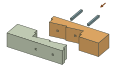
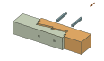
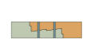

# 追掛大栓継 · Okkake-daisen-tsugi

To lange, modsat rettede profiler mates ind fra siden. På bjælkens overside viser den færdige samling en skiftende kontur; på siden kan de to stiftender ses.

## Samleretningen

Hold profilerne parallelle, og før den okkerfarvede del på tværs hen til den grønne. Når hullerne flugter, indføres de to firkantede stifter. De er vist fra samme side i vores principmodel.

## Læs snittet

Plansnittet i stifthøjde åbner begge tværgående stifter. Følg skiftet ved midten og trinene ved enderne. Dette eksempel har fri montagevej fra siden.

## Ved en besigtigelse

Tegn den ledige plads ud for bjælkens side før du sammenligner med kanawatsugi. De to samlinger kan ligne hinanden i lukket tilstand og kræve forskellig plads til montage.

[JAANUS · okkakedaisentsugi](https://www.aisf.or.jp/~jaanus/deta/o/okkakedaisentsugi.htm)

[SolidCraft-model](model.sc) · [Modelopskrift](model.json) · [Bogen](../README.md)
