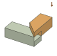
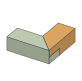

# 大留 · Ōdome

Se kun på hjørnets overside først. Det kunne være en almindelig gering. Løft så det okkerfarvede stykke. Under diagonalen viser der sig en trekantet læbe og en flade, den kan hvile på.

I denne ōdome sænkes læben ned i hjørnets udskæring. Ovenpå kommer de skrå kanter til at mødes. Nedenunder fortsætter det grønne træ ud i hjørnet. Først når man har set begge lag, har man set hele samlingen.

Det forklarer, hvorfor en god tegning af et gammelt listehjørne godt kan slutte med en åben detalje. Selve diagonalen er let at tegne sikkert. Om der ligger en læbe bag den, kræver en fri kant eller en tegning, der viser indgrebet.

[JAANUS · tome](https://www.aisf.or.jp/~jaanus/deta/t/tome.htm)

[SolidCraft-model](model.sc) · [Modelopskrift](model.json) · [Bogen](../README.md)
