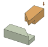

# 大留 · Ōdome

En udvendig geringsfuge kan skjule en overlapning nede i hjørnet. JAANUS beskriver ōdome som en halvbladning med et trekantet indgreb.

## Samleretningen

Lad den trekantede læbe gå ned i hjørnets tilsvarende udsparing. På oversiden falder de to skrå snit sammen til én diagonal.

## Læs snittet

Det høje plansnit går gennem trekanten. Sammenlign toppen med den adskilte del: nedenunder fortsætter det grønne emne helt ud til hjørnet.

## Ved en besigtigelse

Undersøg en synlig endekant eller en original detaljetegning. En pæn diagonal på oversiden er også mulig ved en enkel tome.

[JAANUS · tome](https://www.aisf.or.jp/~jaanus/deta/t/tome.htm)

[SolidCraft-model](model.sc) · [Modelopskrift](model.json) · [Bogen](../README.md)
