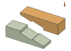
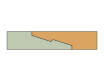

# 略鎌 · Ryakukama

Lad blyanten følge den lange skrå fuge. Et lille stykke inde vender den kort opad, før den fortsætter ned igen. Det lille modhak er værd at standse ved. På afstand kunne man have taget det hele for ét skråt snit.

I denne ryakukama sænkes de to halvdele sammen. De skrå flader kommer til at ligge mod hinanden, og ved hakket møder træet en flade, der vender den anden vej. Den historiske undersøgelses første figurblad viser både denne grundprofil og former, hvor tømreren har føjet andre indgreb til.

Når du møder formen i et hus, så tag også dens omgivelser med på skitsen. Hvor i bygningen sidder den? Hvilke sider kunne oprindelig ses? De spørgsmål hjalp forskeren med at følge samlingens historie. En bestemt hakform giver ikke i sig selv en datering.

[JAANUS · ryakukama](https://www.aisf.or.jp/~jaanus/deta/r/ryakukama.htm) · [Architectural Institute of Japan · fig. 1–3](https://www.jstage.jst.go.jp/article/aijax/356/0/356_KJ00004080403/_pdf#page=1)

[SolidCraft-model](model.sc) · [Modelopskrift](model.json) · [Bogen](../README.md)
